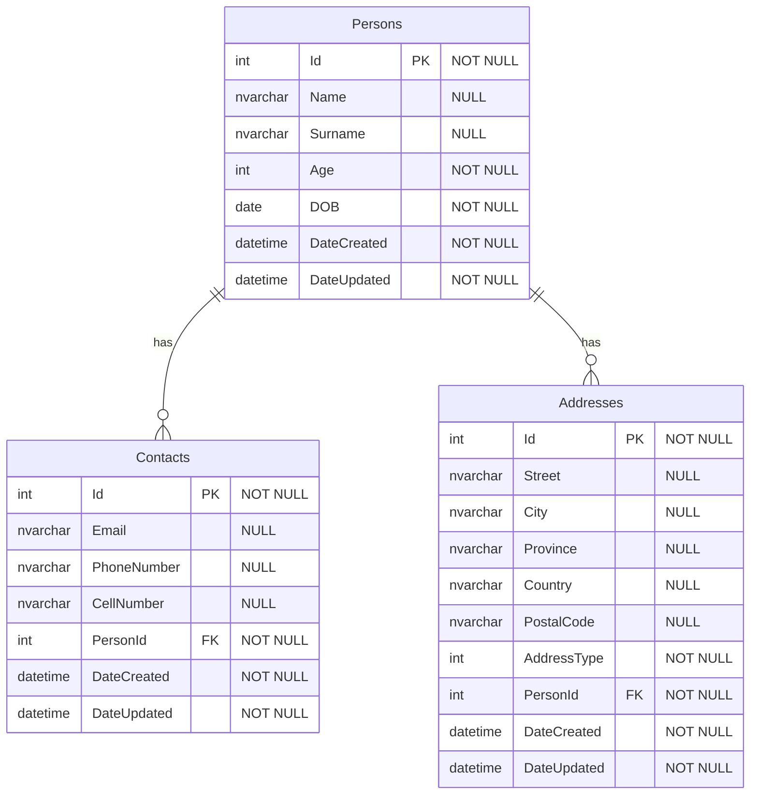

# RTT.Assessment

## 📖 Technology Used
 - ⚡ .NET Core & C# ( Visual Studion 2026
 - ⚡ Local SQL Server
 - ⚡ IMediator
 - ⚡ Dapper ORM
     
   
---

## Database ERD

## Designed Patterns & Approach
  - ⚡ ### SOLID Pattern -
  - ⚡ ### Clean Pattern -

---
## Todo
 - ⚡ ### Test Project - Not completed due to time constraints
 - ⚡ ### Person Report - Not completed due to time constraints but handler created only to output into xls outsanding
 - ⚡ ### Controller  - Not all controller end point be created such as address completed due to time constraints
 - ⚡ ### Logging  - Serilog has been setup but not implemented across application ( Handlers etc )

---
## How To Run
 - ⚡  Repository - Download the repository locally
 - ⚡  DB - DB scrip has been created and need to connect to localDB and run the scipt to generates table (db Name : RTTAssessment)
 - ⚡  Api Documentation - URL to run once compiled ( https://localhost:7009/swagger/index.html )

